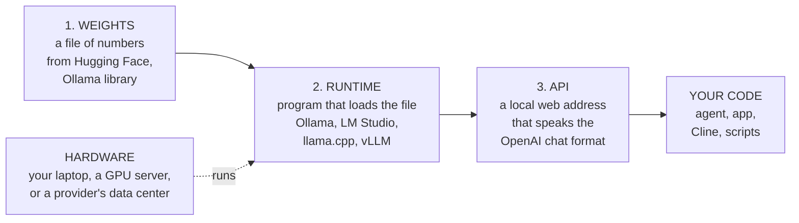
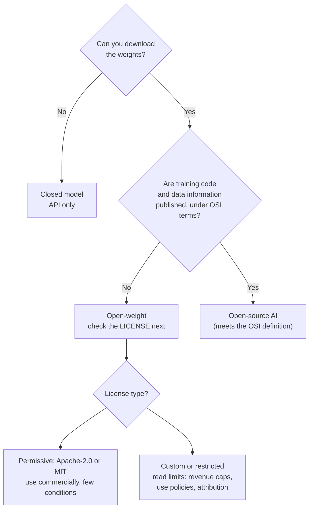
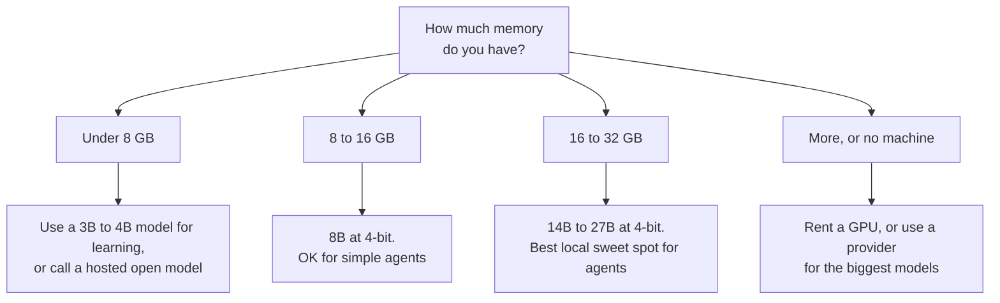
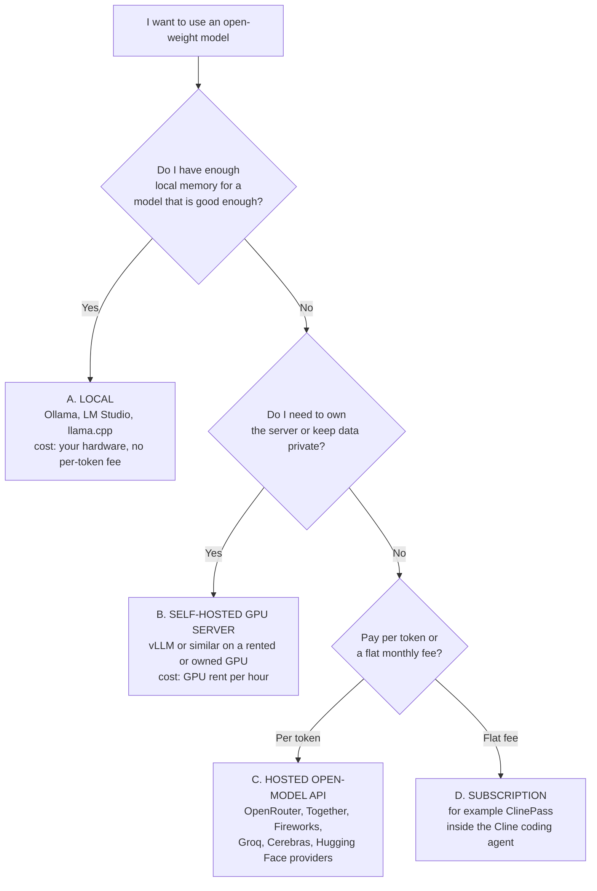
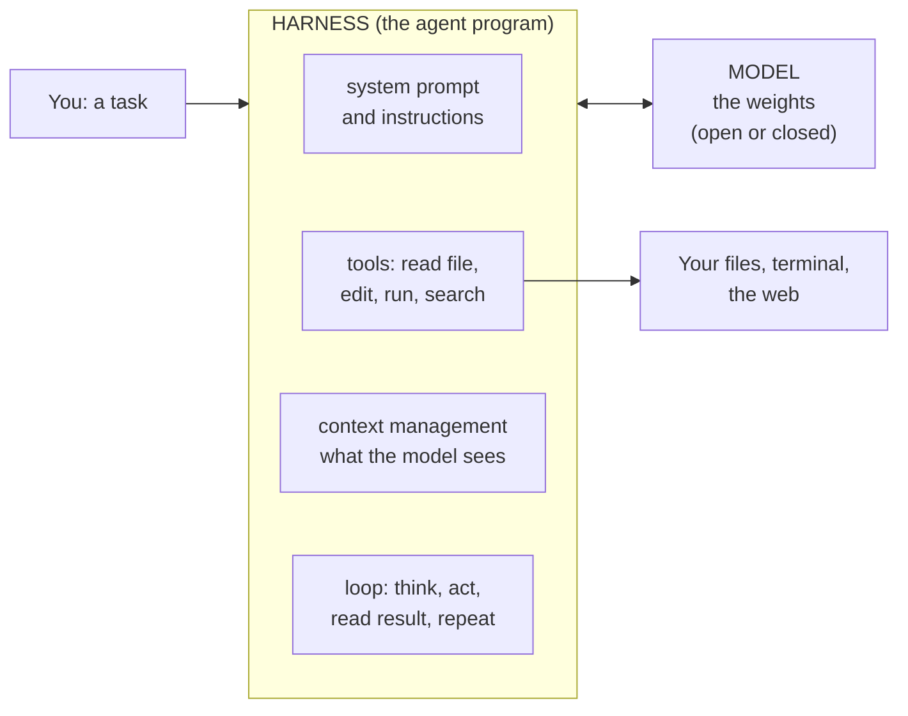
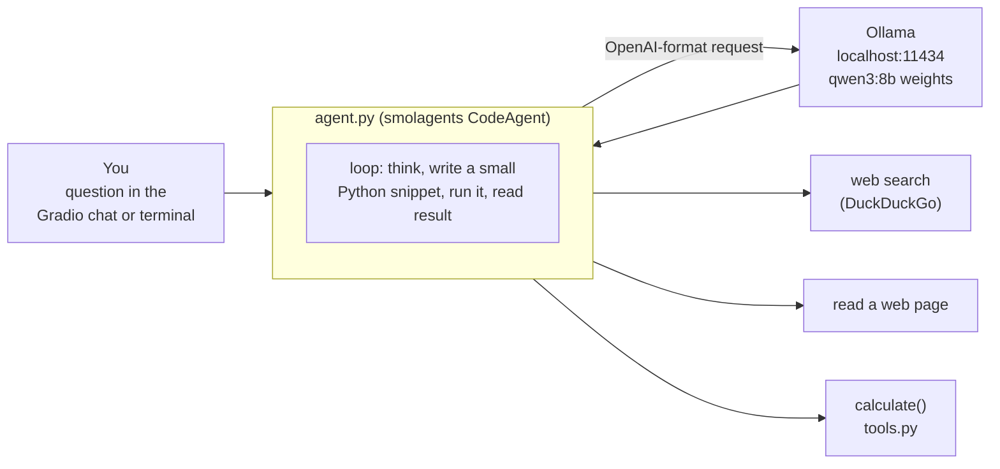

# Open-Weight Models for Agent Builders: A Beginner's Guide

Learn how to **find**, **host**, and **connect to** open-weight AI models, then build a small agent that runs on a model you control, with no per-token API bill.

> Written for someone completely new to this. Every term is explained when it first appears. Facts about the fast-moving model market are dated **October 2026** and linked to sources; verify prices and model names before relying on them.

## Contents

1. [The big picture](#1-the-big-picture)
2. [Open weight vs open source](#2-open-weight-vs-open-source)
3. [Where to get open-weight models](#3-where-to-get-open-weight-models)
4. [Hosting: where the model runs](#4-hosting-where-the-model-runs)
5. [Connecting to a model and using it](#5-connecting-to-a-model-and-using-it)
6. [Why the agent harness matters (Cline, ClinePass)](#6-why-the-agent-harness-matters-cline-clinepass)
7. [Project: a free research agent](#7-project-a-free-research-agent)
8. [Your path, costs, and pitfalls](#8-your-path-costs-and-pitfalls)
9. [Glossary](#9-glossary)
10. [Sources and what I did not verify](#10-sources-and-what-i-did-not-verify)

---

## 1. The big picture

A model is a big file of numbers (the **weights**). To use it you need three layers, and each layer has interchangeable parts. Once you see the layers, every tool name in this field falls into one box.



Read it left to right:

- **Weights** are the model itself (in an LLM, the 70 billion or 8 billion adjustable numbers learned in training).
- A **runtime** (also called an inference engine) loads the weights into memory and turns text into more text.
- The runtime exposes an **API**. Almost everyone copies the OpenAI chat format, so one line of code (the **base URL**) decides which model you talk to.
- Your **agent** does not care where the model lives. That single fact is what lets you start free on a laptop and move to a rented server later without rewriting code.

**Example.** `ollama pull qwen3:8b` downloads weights. `ollama serve` is the runtime. `http://localhost:11434/v1` is the API address. Your Python code points at that address.

---

## 2. Open weight vs open source

People use the two phrases as if they were the same. They are not.

| | Closed model | **Open-weight** model | **Open-source** AI (OSI definition) |
| --- | --- | --- | --- |
| Can you download the weights? | No, only through a company's API | **Yes** | Yes |
| Can you run it yourself? | No | **Yes** | Yes |
| License | Terms of service | A license that varies: permissive, or with conditions | Must be an OSI-approved license |
| Training code published? | No | Often partly, not guaranteed | **Required** (complete code to train and run) |
| Training data described? | No | Often not | **Required** (detailed "data information") |
| Typical examples | GPT, Claude, Gemini | Llama, Qwen, DeepSeek, Gemma, gpt-oss | AI2's OLMo (from my knowledge; check the project) |

**What "open source AI" means.** The Open Source Initiative (OSI) published a formal definition (the OSAID). It says an Open Source AI system must grant four freedoms: to **use** it for any purpose without asking permission, to **study** it and inspect its components, to **modify** it for any purpose, and to **share** it with or without modifications. To make those freedoms real, you need the "preferred form for making modifications", which it lists as three things:

1. **Data information:** "sufficiently detailed information about the data used to train the system" so a skilled person could build a substantially equivalent system (the data itself does not have to be handed over).
2. **Code:** "the complete source code used to train and run the system".
3. **Parameters:** the weights, under OSI-approved terms.

Source: [Open Source AI Definition](https://opensource.org/ai/open-source-ai-definition).

**So what is an open-weight model?** A model whose weights you can download and run. That is a real and useful freedom, but it is only the third of three ingredients. Most famous "open" models are open-weight: you get the file, but not the training data or full training pipeline.



**Licenses you will meet** (verify each model's page, since licenses change between versions; this is not legal advice):

| License style | What it usually means | Examples reported in October 2026 |
| --- | --- | --- |
| **Apache-2.0** | Permissive: commercial use allowed, keep the notice | Qwen3.8-27B, Mistral Small 4 |
| **MIT** | Very permissive | GLM-5.2, DeepSeek V4 |
| **Custom with a revenue threshold** | Free below a size, separate agreement above it | Kimi K3 (above $20M annual revenue), MiniMax-M3 ($20M), Qwen3.8-Max ($50M) |

Sources for the table: [fastino guide](https://fastino.ai/blog/how-to-use-open-weight-models), [kingy.ai shortlist](https://kingy.ai/news/best-open-weight-ai-models-in-2026-glm-5-2-vs-deepseek-v4-vs-kimi-k2-6-vs-qwen-vs-mistral/). Meta's Llama uses its own community license with conditions; the OSI has said that kind of license does not meet its definition (from my knowledge; check the license text).

**Why this matters to you.**

- **Building agents or products:** the license is what you need to read (can I use this commercially, can I fine-tune it?). Openness of training data matters less.
- **Writing research papers:** openness matters more. Without training data and code you cannot reproduce or audit a model, so prefer fully open releases (for example OLMo) when the claim depends on knowing the data.
- **Be careful with the word "open".** Companies often write "open-source" for open-weight releases. Ask: can I get the weights, what does the license allow, and is the data described?

---

## 3. Where to get open-weight models

| Place | What it is | Best for |
| --- | --- | --- |
| [**Hugging Face Hub**](https://huggingface.co/models) | The main catalog: weights, model cards, licenses, community discussion | Finding anything; research; fine-tuning |
| [**Ollama library**](https://ollama.com/library) | Models pre-packaged for one-command local running | Beginners, laptops |
| **LM Studio** | A desktop app with a built-in model browser and chat | Trying models without a terminal |
| **Provider catalogs** (OpenRouter, Together AI, Fireworks, Groq, Cerebras) | You do not download; you call hosted copies of open models | Big models you cannot run locally |
| **ModelScope** | Alibaba's model hub | Qwen-family releases |

### How to read a model page (the card)

Check these in order before you download 20 GB:

1. **License** (section 2).
2. **Size:** parameters (8B = 8 billion). For **mixture-of-experts (MoE)** models you will see two numbers, for example "320B total, 18B active": all 320B must fit in memory, but only 18B work per token, so it runs faster than its size suggests.
3. **Instruct or base:** choose **instruct/chat** versions for assistants and agents. Base models only continue text.
4. **Tool or function calling support:** agents need it. On Ollama, look for the *tools* tag on the model page.
5. **Context length:** how much text it can read at once (8K to 1M tokens). Longer context costs more memory.
6. **File format:** `safetensors` (standard weights), `GGUF` (the compact format used by llama.cpp, Ollama, LM Studio), `MLX` (Apple Silicon). The format must match your runtime.
7. **Quantization:** storing numbers in 8 or 4 bits instead of 16 so the file shrinks. Small quality loss, big memory savings.

### Will it fit? A rule of thumb

Weights are stored as numbers, so memory is roughly size times bytes per number. At 16 bits (BF16) that is about **2 GB per billion parameters**. At 4-bit it is about a quarter of that, plus overhead for the context (the KV cache). One source reports Qwen3.8-27B fits on a 24 GB RTX 4090 at 4-bit, using about 14 to 16 GB ([fastino](https://fastino.ai/blog/how-to-use-open-weight-models)).

| Model size | Approx. memory at 4-bit | Approx. at 16-bit | Typical machine |
| --- | --- | --- | --- |
| 3B to 4B | 2 to 3 GB | 6 to 8 GB | Any recent laptop |
| 8B | 5 to 6 GB | 16 GB | 16 GB laptop (CPU is slow; GPU or Apple Silicon is better) |
| 14B | 9 to 10 GB | 28 GB | 16 to 24 GB GPU or Mac |
| 27B to 32B | 15 to 20 GB | 54 to 64 GB | 24 GB GPU or 32 GB+ Mac |
| 70B | about 40 GB | 140 GB | Two GPUs, or a 64 GB+ Mac |

These are estimates from the 2-GB-per-billion rule; real use depends on context length and runtime.



### Which models are popular now (October 2026)

A June 2026 comparison, updated through August to October, lists these as the open-weight leaders (vendor benchmark claims are not independently verified): **Qwen3.8-27B** (Apache-2.0; called the practical local default for one workstation), **DeepSeek V4-Flash** (MIT; strongest cost-and-agent option in that group), **GLM-5.3-Flash** (multimodal; 320B total, 18B active), **Mistral Small 4** (Apache-2.0; 119B total, 6.5B active), and **Kimi K3** (2.8 trillion parameters; rack-scale hardware to self-host). Earlier favorites still in use include **Qwen3-Coder-Next** (80B total, 3B active, built for local coding agents) and **gpt-oss** from OpenAI. Source: [kingy.ai](https://kingy.ai/news/best-open-weight-ai-models-in-2026-glm-5-2-vs-deepseek-v4-vs-kimi-k2-6-vs-qwen-vs-mistral/). The ranking changes monthly: treat the list as a starting point and check the Hugging Face and Ollama pages.

### Downloading from Hugging Face

```bash
pip install -U "huggingface_hub[cli]"
hf download Qwen/Qwen3-8B --local-dir ./qwen3-8b     # pick the exact repo from the model page
```

Use the `hf` download command rather than `git clone`: a clone can fetch tiny pointer stubs instead of the real weights ([fastino](https://fastino.ai/blog/how-to-use-open-weight-models)). With Ollama you skip this: `ollama pull qwen3:8b` does download, packaging, and storage in one step.

---

## 4. Hosting: where the model runs

**Hosting** simply means "which computer runs the runtime." There are five common choices. They trade **cost**, **control**, and **effort**.



| Option | How it works | Cost shape | Main upside | Main downside |
| --- | --- | --- | --- | --- |
| **A. Local** (Ollama, LM Studio, llama.cpp) | Model runs on your machine | Hardware you already own; electricity | **No API bill**, private, works offline | Limited to models that fit; slower on laptops |
| **B. Self-hosted server** (vLLM, SGLang, TGI) | You run an inference engine on a GPU box | GPU rental per hour | Full control; fast with many users; any open model | You manage the server |
| **C. Hosted open-model API** | A company runs the open model; you pay per token | Cents per million tokens for small models | Biggest models, no hardware | Per-token cost; your data goes to a provider |
| **D. Subscription** | Flat monthly plan that bundles several open models | See below | Predictable bill | Tied to one product's rules |
| **E. Closed API** (for comparison) | Not open weight | Highest per token | Frontier quality | Cost; no control |

**Reference prices (per million input/output tokens), as reported in one October 2026 guide:** gpt-oss-20b on Groq $0.075 / $0.30; Gemma-4-26B-A4B $0.12 / $0.37; Qwen3.8-27B $0.50 / $3.00; DeepSeek V4 Pro (off-peak) $0.66 / $1.98; GLM 5.3 $1.40 / $4.40; Kimi K3 $3.00 / $15.00 ([fastino](https://fastino.ai/blog/how-to-use-open-weight-models)). Prices move: check the provider.

**Hugging Face Inference Providers.** Hugging Face routes requests to many providers at the provider's own price with no markup. Its pricing page says **free accounts get no included credits** (you must buy credits to use it), while PRO accounts get $2 of monthly credits ([pricing page](https://huggingface.co/docs/inference-providers/pricing)). So the Hugging Face API is **not** a free path for agents; running locally is.

**ClinePass (a subscription, option D).** Announced June 29, 2026 as a flat plan for the Cline coding agent: **$9.99 per month** (first month $1.99 as a CLI promotion), bundling open-weight coding models such as GLM-5.2, Kimi K2.7 Code, Kimi K2.6, DeepSeek V4 Pro, DeepSeek V4 Flash, and MiMo V2.5 / V2.5 Pro. You select it as the provider in Cline instead of managing separate accounts, and can still bring your own keys or a local model in the same project. Reported limits are "2 to 5 times standard API rate limits" ([source](https://www.creativeainews.com/blog/clinepass-open-weight-coding-models-cline-2026/)). Worth it if you code in Cline daily; not needed if you are building your own agent against a local model.

### Understanding the speed and memory vocabulary

- **Tokens per second:** how fast the model writes. Local 8B on a laptop CPU may give a few per second; a good GPU gives dozens.
- **KV cache:** memory the runtime uses to remember the conversation so far. Longer chats use more.
- **Context cap:** if you run out of memory, lower the maximum context (the vLLM example in the fastino guide caps it at 32K on a 24 GB card).
- **Batching:** servers like vLLM serve many users at once efficiently; laptop tools are built for one user.

---

## 5. Connecting to a model and using it

### The one idea: the OpenAI-compatible API

Nearly every runtime and provider accepts the same request shape (`POST /v1/chat/completions`). So to switch models you change **three strings**: the **base URL**, the **model name**, and the **API key**.

| Where the model runs | `base_url` | `api_key` | `model` |
| --- | --- | --- | --- |
| Ollama on your machine | `http://localhost:11434/v1/` | any text (ignored), e.g. `ollama` | `qwen3:8b` |
| vLLM server | `http://localhost:8000/v1` | any text | the model you served |
| LM Studio | `http://localhost:1234/v1` (default; check the app) | any text | the loaded model |
| A hosted provider | the provider's URL | your real key | the provider's model name |

Ollama's compatible API is documented [here](https://docs.ollama.com/api/openai-compatibility): it supports streaming, tools, JSON mode, and vision (base64 images), but not `tool_choice` or `logprobs`.

```python
from openai import OpenAI                      # pip install openai

client = OpenAI(base_url="http://localhost:11434/v1/", api_key="ollama")

reply = client.chat.completions.create(
    model="qwen3:8b",
    messages=[{"role": "user", "content": "In one sentence, what is an open-weight model?"}],
)
print(reply.choices[0].message.content)
```

Switch to a hosted provider by changing only the first line's two arguments and the model name. That is why the project in section 7 keeps these three values in environment variables.

### Tool calling: the part that breaks

Agents need the model to emit a structured request ("call `search` with this text"). Things to know:

- Not every open model is good at it. Small models fail more often; start at 8B or larger.
- The **server must parse the model's tool format correctly**. If it does not, tool calls arrive as ordinary text with **no error**, and your agent silently does nothing ([fastino](https://fastino.ai/blog/how-to-use-open-weight-models)).
- **Set sampling explicitly.** One source found a Qwen model's default temperature of 1.0 produced repetitive output on long runs and 0.1 fixed it. For agents, a low temperature is a good starting point.
- **Test on at least 20 real tasks** before trusting a switch from one model to another.

### Using open models in coding tools

Cline, OpenCode, Zed, Aider, and Continue accept a custom base URL, so the table above works there too. To run Claude Code against another provider, set `ANTHROPIC_BASE_URL` and `ANTHROPIC_API_KEY`. If your code uses the Anthropic SDK, either convert to OpenAI-format calls or run **LiteLLM** as a translating proxy ([fastino](https://fastino.ai/blog/how-to-use-open-weight-models)).

---

## 6. Why the agent harness matters (Cline, ClinePass)

A common beginner mistake: "model X scored higher, so it will be better for me." In practice the same model behaves differently in different **harnesses**.



The **model** is the brain. The **harness** is everything around it: the instructions it is given, the tools it may call, how much of your project it sees each step, and when it stops. A strong model in a weak harness can lose to a smaller model in a good one. **Cline** is a harness for coding inside VS Code or the terminal. It has two modes that teach a good habit:

- **Plan mode:** the agent reads your code and proposes an approach with no changes made. You review and correct the plan.
- **Act mode:** the agent edits files and runs commands to carry out the approved plan.

**Lesson for you:** separate "decide what to do" from "do it," and let a human check in between. You will rebuild this pattern in your own agents.

**How to judge models fairly.** Benchmarks (public scores) are often measured in the lab's own harness, and labs can train toward them. The most reliable test is your own: pick 20 tasks from your real work and run each candidate model through the same harness. The creator of the video this guide was based on built a tool for this ([woaibench.ai](https://www.woaibench.ai/); I have not tested it, and benchmark results shown in videos are the creator's own claims).

---

## 7. Project: a free research agent

**Goal:** an agent that answers questions by searching the web, reading pages, and doing math, powered by an open-weight model **running on your computer**, with **no API cost**.

**What you will learn:** the three layers from section 1 in practice; how a tool is "just a documented Python function"; how to swap models by changing environment variables.



[smolagents](https://huggingface.co/docs/smolagents/index) is Hugging Face's small agent library. Its `CodeAgent` has the model write short Python snippets that call tools, which tends to need fewer steps than JSON tool calls.

### Files

| File | Purpose |
| --- | --- |
| [`project/agent.py`](project/agent.py) | `build_model()` picks the backend from env vars; `build_agent()` adds the tools |
| [`project/tools.py`](project/tools.py) | A custom `calculate` tool, with a safe expression parser (no `eval`) |
| [`project/app.py`](project/app.py) | Chat UI in your browser, or a one-shot terminal question |
| [`project/check_setup.py`](project/check_setup.py) | Step 0: confirms your model connection works |
| [`project/tests/`](project/tests) | Unit tests plus an end-to-end test using a fake model server |
| [`project/.env.example`](project/.env.example) | All settings in one place |

### Run it (about 15 minutes)

```bash
# 1. Install Ollama from https://ollama.com, then download a model (about 5 GB)
ollama pull qwen3:8b

# 2. Get the project
cd project
python -m venv .venv && source .venv/bin/activate     # Windows: .venv\Scripts\activate
pip install -r requirements.txt

# 3. Prove the connection works (do this first!)
python check_setup.py

# 4. Ask something, in the terminal or the browser
python app.py "What is 17% of 2,340, and who won the most recent Tour de France?"
python app.py            # opens the chat UI at http://127.0.0.1:7860
```

If `check_setup.py` fails, its message tells you whether the server is down or the model name is wrong.

### Change the model without changing code

```bash
export MODEL_ID=gpt-oss:20b                      # another Ollama model (needs ~16 GB memory)

# A model on a vLLM server or any OpenAI-compatible provider:
export MODEL_BACKEND=openai_compatible
export API_BASE=http://localhost:8000/v1
export MODEL_ID=your-model-name
export API_KEY=your-key-or-anything
```

### Make it your own (exercises)

1. **Add a tool.** Write `word_count(text: str)` in `tools.py` with a docstring and type hints, then add it to the tool list in `agent.py`. Watch the agent choose it.
2. **Compare two models.** Write 10 questions in a file, run both `qwen3:8b` and a larger model, and count correct answers and seconds. This is your own mini benchmark (section 6).
3. **Add a Plan step.** Set `planning_interval=2` in `build_agent` so the agent re-plans every 2 steps, like Cline's Plan mode.
4. **Run it in a sandbox.** Change the agent to `executor_type="docker"` so model-written code never runs directly on your machine.

### Put it on Hugging Face (optional)

A **Hugging Face Space** hosts a Gradio app for free, but free Spaces have no GPU and no Ollama, so they cannot run the 8B model themselves. Two honest options:

- **Showcase:** push the code to a Space and set `MODEL_BACKEND=hf` plus an `HF_TOKEN` secret. That uses Inference Providers, which can cost credits (section 4).
- **Keep it local** and put the code on GitHub, with a screenshot in the README. This is the genuinely free path.

### What was verified

The tests (`pytest`) pass here, including an end-to-end run of the agent against a fake OpenAI-compatible server: agent, API call, tool execution, and final answer all work. I could **not** test it against a real downloaded model in this environment, so quality and speed with your real model are for you to check with `check_setup.py` and the exercises.

---

## 8. Your path, costs, and pitfalls

### What "free" really costs

| Path | Per-token fee | What you pay instead |
| --- | --- | --- |
| Local (Ollama, LM Studio) | None | Your hardware and electricity; smaller, slower models |
| Hosted open-model API | Small | Cents per million tokens; data leaves your machine |
| Subscription (ClinePass) | None | $9.99 per month; one product |
| Closed API | Highest | Money for the strongest models |

### A four-step path for building agents

1. **Week 1:** Run section 7 as written. Make the connection check pass.
2. **Week 2:** Add two tools and compare two models on 10 of your own questions.
3. **Week 3:** Move the same agent to a hosted open model by changing three env vars; compare quality and cost.
4. **Week 4:** Add Plan/Act separation and a sandbox; write up what you learned in this repo.

### Common pitfalls

| Symptom | Likely cause | Fix |
| --- | --- | --- |
| "Connection error" | Runtime not running, or wrong URL | Start `ollama serve`; check the base URL |
| Model not found | Typo or never pulled | Match `ollama list` exactly |
| Agent never calls tools | Model too small, or server mis-parses tool format | Try a larger model; test tool calling on its own |
| Repeats itself | Temperature too high | Lower it (try 0.1 to 0.3) |
| Out of memory | Model or context too big | Smaller model, 4-bit version, lower context |
| Very slow | Running on CPU | Use a smaller model, or a GPU / Apple Silicon |
| Great benchmark, bad results | Different harness or tasks | Test on your own tasks |

---

## 9. Glossary

| Term | Meaning |
| --- | --- |
| **Weights / parameters** | The learned numbers that make up the model |
| **Open weight** | Weights you can download and run, under some license |
| **Open source AI** | Meets the OSI definition: weights, code, and data information, under OSI-approved terms |
| **Inference** | Running a trained model to get answers |
| **Runtime / inference engine** | Software that loads weights and runs them (Ollama, llama.cpp, vLLM) |
| **Quantization** | Storing weights with fewer bits (8 or 4) to save memory |
| **GGUF / safetensors / MLX** | File formats: compact local format / standard weights / Apple Silicon |
| **Instruct model** | A model finetuned to follow instructions; use it for assistants |
| **MoE (mixture of experts)** | Big total size, but only a few "experts" work per token |
| **Context window** | How much text the model can read at once |
| **KV cache** | Memory for the conversation so far; grows with context |
| **Base URL** | The address your code sends requests to; changing it switches models |
| **OpenAI-compatible API** | The shared request format almost every runtime and provider copies |
| **Tool / function calling** | The model asking a program to do something and reading the result |
| **Agent** | A loop where a model thinks, calls tools, reads results, and repeats |
| **Harness** | Everything around the model in an agent: prompt, tools, context handling, loop |
| **VRAM** | A graphics card's memory; usually the limit for model size |
| **LoRA** | A cheap way to fine-tune by training small add-on layers |

---

## 10. Sources and what I did not verify

**Read for this guide (October 2026):**

- [Open Source AI Definition](https://opensource.org/ai/open-source-ai-definition) (OSI): the four freedoms and the data/code/parameters requirements.
- [How to Use Open-Weight Models in 2026](https://fastino.ai/blog/how-to-use-open-weight-models): download, hosting, connection, prices, licenses, tool-calling cautions.
- [Best open-weight AI models 2026](https://kingy.ai/news/best-open-weight-ai-models-in-2026-glm-5-2-vs-deepseek-v4-vs-kimi-k2-6-vs-qwen-vs-mistral/): the shortlist; updated through October 7, 2026.
- [ClinePass article](https://www.creativeainews.com/blog/clinepass-open-weight-coding-models-cline-2026/): price, included models, limits.
- [Ollama OpenAI compatibility](https://docs.ollama.com/api/openai-compatibility) and [Hugging Face Inference Providers pricing](https://huggingface.co/docs/inference-providers/pricing).
- [smolagents documentation](https://huggingface.co/docs/smolagents/index).

**From my own knowledge, not re-checked:** that OLMo publishes data and code and counts as fully open; the OSI's position on Llama's license; how Cline's Plan and Act modes work in detail; the memory rule of thumb per billion parameters (a standard estimate, but check your runtime).

**Not independently verified:** vendor benchmark claims for GLM, DeepSeek, Kimi, and Qwen; the prices and model versions above, which change often; the creator's benchmark tool mentioned in section 6. **This guide is not legal advice**: read each model's license for your own use.
